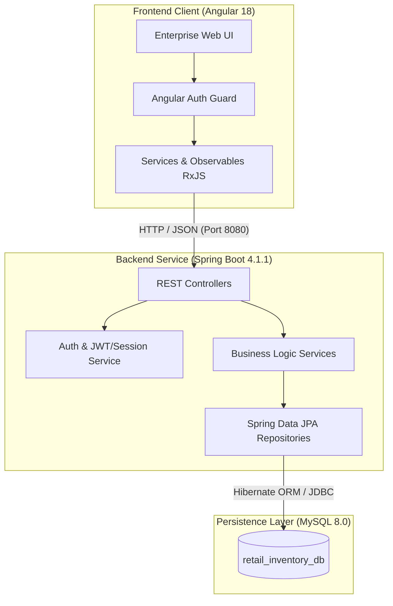
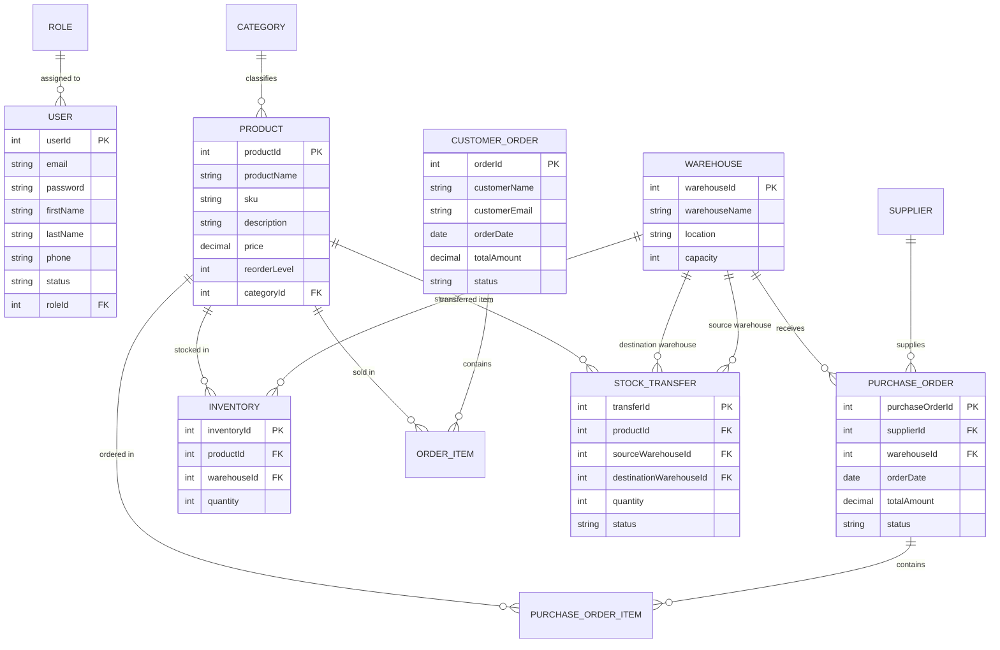

# 📦 RetailFlow Enterprise — Retail Inventory Management System

[](https://spring.io/projects/spring-boot)
[](https://www.oracle.com/java/)
[](https://angular.dev/)
[](https://www.typescriptlang.org/)
[](https://www.mysql.com/)
[](LICENSE)

> **RetailFlow Enterprise** is a full-stack, enterprise-grade inventory, supply chain, and order fulfillment platform. Engineered for distributed retail operations, it orchestrates multi-warehouse inventory levels, automated low-stock replenishment, supplier procurement workflows, customer sales fulfillment, and granular role-based access control (RBAC).

---

## 📑 Table of Contents

- [Key Features](#-key-features)
- [System Architecture](#-system-architecture)
- [Tech Stack](#-tech-stack)
- [Data Model & ER Diagram](#-data-model--er-diagram)
- [Role-Based Access Control (RBAC)](#-role-based-access-control-rbac)
  - [Pre-Seeded Demo Accounts](#pre-seeded-demo-accounts)
  - [Permissions Matrix](#permissions-matrix)
- [API Reference](#-api-reference)
- [Project Directory Structure](#-project-directory-structure)
- [Getting Started](#-getting-started)
  - [Prerequisites](#prerequisites)
  - [1. Database Configuration](#1-database-configuration)
  - [2. Backend Setup (Spring Boot)](#2-backend-setup-spring-boot)
  - [3. Frontend Setup (Angular)](#3-frontend-setup-angular)
- [Core Operational Workflows](#-core-operational-workflows)
- [Testing & Quality Assurance](#-testing--quality-assurance)
- [Contributing & License](#-contributing--license)

---

## 🌟 Key Features

### 🏬 Multi-Warehouse Inventory Management
- **Multi-Location Visibility**: Track SKU balances, unit pricing, and storage capacities across distinct fulfillment centers.
- **Dynamic Low-Stock Engine**: Automatically highlights inventory levels falling below safety reorder thresholds with real-time visual alerts.
- **Direct Stock Movements**: Initiate and approve inter-warehouse stock transfers with automatic source deduction and destination replenishment.

### 🔄 Procurement & Supplier Lifecycle
- **Vendor Directory**: Manage active supplier contracts, contact records, and catalog linkages.
- **Purchase Order (PO) Processing**: Draft, issue, and track purchase orders with automated stock balance updates upon marking shipments as `RECEIVED`.

### 🛒 Sales & Customer Fulfillment
- **Omnichannel POS / Order Placement**: Manage customer purchase orders with real-time stock availability verification and line-item totals calculation.
- **Order Lifecycle Tracking**: Seamless progression across `PLACED`, `PROCESSING`, `COMPLETED`, and `CANCELLED` statuses.

### 🛡️ Role-Tailored Dashboards & RBAC
- **5 Dedicated Personas**: Specialized views and quick actions tailored for **Admin**, **Warehouse Manager**, **Store Retailer**, **Procurement Specialist**, and **Customer**.
- **Contextual Metrics**: Real-time KPI summary cards reflecting catalog size, low-stock alerts, active warehouses, and pending actions.
- **Secure Route Guards**: Angular route protection combined with Spring Boot backend authorization.

### 🎨 Modern Enterprise UI/UX
- **Design System**: Refined cobalt/indigo palette, obsidian navigation sidebar, glassmorphic metric cards, and responsive tables.
- **Typography & Polish**: Styled with *Plus Jakarta Sans* and *JetBrains Mono*, featuring contextual badges and empty states.

---

## 🏗️ System Architecture



---

## 💻 Tech Stack

| Layer | Technologies & Tools |
| :--- | :--- |
| **Frontend Framework** | [Angular 18](https://angular.dev/) (Standalone Components, Reactive Forms, Router) |
| **Frontend Language** | [TypeScript 5.5](https://www.typescriptlang.org/), [RxJS 7.8](https://rxjs.dev/) |
| **Styling & Design System** | Vanilla CSS3 Design Tokens, Obsidian Dark Sidebar, Plus Jakarta Sans |
| **Backend Framework** | [Spring Boot 4.1.1](https://spring.io/projects/spring-boot) |
| **Backend Language** | [Java 17](https://www.oracle.com/java/) |
| **Data Access & ORM** | [Spring Data JPA](https://spring.io/projects/spring-data-jpa) / [Hibernate ORM](https://hibernate.org/) |
| **Database** | [MySQL 8.0+](https://www.mysql.com/) |
| **Build & Tooling** | Maven 3.x (`mvnw`), Angular CLI 18, Node.js 18+ |

---

## 🗄️ Data Model & ER Diagram



---

## 👥 Role-Based Access Control (RBAC)

The system automatically initializes 5 primary business roles and pre-seeds verified demo accounts upon startup via `DataInitializer.java`.

### Pre-Seeded Demo Accounts

| Role | Email | Password | Full Name | Default Focus |
| :--- | :--- | :--- | :--- | :--- |
| **Admin** | `admin@retailflow.com` | `admin123` | Alex Vance | Full system governance, catalogs, warehouses, user admin |
| **Manager** | `manager@retailflow.com` | `manager123` | Marcus Lee | Warehouse logistics, approving stock transfers, receiving POs |
| **Retailer** | `retailer@retailflow.com` | `retail123` | Sophia Patel | Point-of-sale customer order entry & live catalog lookups |
| **Procurement**| `procurement@retailflow.com`| `procure123`| David Miller | Vendor management, issuing purchase orders, restocking |
| **Customer** | `customer@retailflow.com` | `customer123`| Emma Watson | Self-service product catalog browsing & order placement |

### Permissions Matrix

| Feature Module | Admin | Manager | Retailer | Procurement | Customer |
| :--- | :---: | :---: | :---: | :---: | :---: |
| **Dashboard** | Full Metrics | Logistics View | Sales View | Vendor View | My Orders |
| **Products & Catalog** | Create / Edit / Delete | View Only | View / Sell | Create / Edit | View Only |
| **Categories** | Full CRUD | View Only | View Only | View Only | View Only |
| **Inventory & Stock** | Full Access | Full Access | View Only | View Only | Hidden |
| **Warehouses** | Full CRUD | View / Manage | View Only | View Only | Hidden |
| **Suppliers** | Full CRUD | View Only | Hidden | Full CRUD | Hidden |
| **Purchase Orders** | View / Approve | Receive Stock | Hidden | Create / Edit | Hidden |
| **Customer Orders** | Full Management | View Only | Create & Manage | View Only | Place & View Own |
| **Stock Transfers** | Create & Approve | Create & Approve | Hidden | Hidden | Hidden |
| **User Administration**| Full Access | Hidden | Hidden | Hidden | Hidden |

---

## 🔌 API Reference

The backend exposes RESTful endpoints with standard JSON responses under `/api`:

### Authentication & Profiles (`/api/auth`)
- `POST /api/auth/login` — Authenticate user and issue session/token
- `POST /api/auth/register` — Register a new account
- `GET /api/auth/me` — Retrieve authenticated user profile

### Product Catalog (`/api/products` & `/api/categories`)
- `GET /api/products` — Retrieve all active products
- `GET /api/products/{id}` — Get single product by ID
- `POST /api/products` — Register a new catalog SKU
- `PUT /api/products/{id}` — Update product metadata, SKU, or reorder threshold
- `DELETE /api/products/{id}` — Remove or archive product
- `GET /api/categories` — List all product categories

### Inventory Management (`/api/inventory`)
- `GET /api/inventory` — Get inventory levels across all locations
- `GET /api/inventory/low-stock` — Filter inventory items falling below reorder levels
- `GET /api/inventory/warehouse/{warehouseId}` — Get stock for a specific facility
- `GET /api/inventory/product/{productId}` — Get product stock across warehouses
- `POST /api/inventory` — Add or initialize stock records
- `PUT /api/inventory/{id}` — Adjust inventory quantities

### Stock Transfers (`/api/stock-transfers`)
- `GET /api/stock-transfers` — List all transfer requests
- `POST /api/stock-transfers` — Initiate an inter-warehouse stock transfer (`PENDING`)
- `PUT /api/stock-transfers/{id}` — Approve and execute transfer (`COMPLETED`), moving stock atomically

### Procurement & Purchase Orders (`/api/purchase-orders`)
- `GET /api/purchase-orders` — List purchase orders
- `POST /api/purchase-orders` — Issue new purchase order to supplier
- `PUT /api/purchase-orders/{id}` — Update PO status (e.g., mark as `RECEIVED` to credit warehouse inventory)

### Customer Orders (`/api/customer-orders`)
- `GET /api/customer-orders` — List sales orders
- `POST /api/customer-orders` — Place order and deduct warehouse inventory
- `PUT /api/customer-orders/{id}` — Update order status (`PROCESSING`, `COMPLETED`, `CANCELLED`)

### Facilities & Vendors (`/api/warehouses` & `/api/suppliers`)
- `GET /api/warehouses` / `POST /api/warehouses` — Warehouse management
- `GET /api/suppliers` / `POST /api/suppliers` — Vendor directory management

---

## 📂 Project Directory Structure

```text
RetailManagement/
├── RetailManagement/                   # Spring Boot 4.1.1 Backend
│   ├── src/
│   │   ├── main/
│   │   │   ├── java/com/hcl/RetailManagement/
│   │   │   │   ├── config/             # CORS policies & DataInitializer demo seed
│   │   │   │   ├── controller/         # REST Controllers (Auth, Product, Orders, etc.)
│   │   │   │   ├── dto/                # Data Transfer Objects
│   │   │   │   ├── entity/             # JPA Entities (Product, Inventory, Orders, etc.)
│   │   │   │   ├── exception/          # Global Exception Handlers
│   │   │   │   ├── repository/         # Spring Data JPA Repositories
│   │   │   │   └── service/            # Core Business Logic & Orchestration
│   │   │   └── resources/
│   │   │       ├── application.properties  # Database connection & server configuration
│   │   │       └── static/             # Static web assets
│   │   └── test/                       # Unit & integration tests
│   ├── mvnw / mvnw.cmd                 # Maven Wrapper scripts
│   └── pom.xml                         # Maven dependencies & build configuration
│
└── frontend/                           # Angular 18 Enterprise Client
    ├── src/
    │   ├── app/
    │   │   ├── core/
    │   │   │   ├── guards/             # Route authentication guards
    │   │   │   ├── models/             # TypeScript domain models & interfaces
    │   │   │   └── services/           # HTTP API client services
    │   │   ├── features/               # Modular Feature Components
    │   │   │   ├── auth/               # Login & authentication view
    │   │   │   ├── dashboard/          # Persona-aware dynamic KPI dashboard
    │   │   │   ├── products/           # Catalog list & product form
    │   │   │   ├── inventory/          # Multi-warehouse stock tracking
    │   │   │   ├── warehouses/         # Storage facilities
    │   │   │   ├── suppliers/          # Vendor directory
    │   │   │   ├── purchase-orders/    # Inbound PO generation & receipt
    │   │   │   ├── customer-orders/    # Sales order intake & fulfillment
    │   │   │   ├── stock-transfers/    # Inter-warehouse logistics
    │   │   │   └── users/              # RBAC administration
    │   │   └── shared/                 # Reusable layout, navigation & components
    │   ├── environments/               # API base URL environments
    │   └── styles.css                  # Global design tokens & styling
    ├── angular.json                    # Angular workspace configuration
    └── package.json                    # Node dependencies & npm scripts
```

---

## 🚀 Getting Started

### Prerequisites

Ensure you have the following installed on your machine:
- **Java Development Kit (JDK)**: Version 17 or higher (`java -version`)
- **Node.js**: Version 18.x or 20.x (`node -v`) and **npm** (`npm -v`)
- **MySQL Server**: Version 8.0 or higher
- **Git**

---

### 1. Database Configuration

1. Launch your MySQL command line client or workbench:
   ```sql
   CREATE DATABASE retail_inventory_db;
   ```
2. Verify that MySQL is running on port `3306`.

---

### 2. Backend Setup (Spring Boot)

1. Navigate to the backend directory:
   ```bash
   cd RetailManagement
   ```

2. Review or update database credentials in `src/main/resources/application.properties`:
   ```properties
   spring.datasource.url=jdbc:mysql://localhost:3306/retail_inventory_db?createDatabaseIfNotExist=true&useSSL=false&serverTimezone=UTC
   spring.datasource.username=root
   spring.datasource.password=YOUR_MYSQL_PASSWORD
   spring.datasource.driver-class-name=com.mysql.cj.jdbc.Driver

   spring.jpa.hibernate.ddl-auto=update
   spring.jpa.show-sql=true
   spring.jpa.properties.hibernate.format_sql=true
   server.port=8080
   ```

3. Build and launch the Spring Boot application:
   - **On Windows (PowerShell/CMD):**
     ```powershell
     .\mvnw.cmd spring-boot:run
     ```
   - **On Linux / macOS:**
     ```bash
     chmod +x mvnw
     ./mvnw spring-boot:run
     ```

4. The backend will start on **`http://localhost:8080`**. Upon first run, `DataInitializer` will automatically populate default roles and demo accounts.

---

### 3. Frontend Setup (Angular)

1. In a new terminal window, navigate to the frontend directory:
   ```bash
   cd frontend
   ```

2. Install project dependencies:
   ```bash
   npm install
   ```

3. Launch the development server:
   ```bash
   npm start
   # or
   npx ng serve
   ```

4. Open your browser and navigate to:
   ```text
   http://localhost:4200
   ```

5. Log in using any of the [Pre-Seeded Demo Accounts](#pre-seeded-demo-accounts) (e.g., `admin@retailflow.com` / `admin123`).

---

## 🔄 Core Operational Workflows

### 1. Inbound Stock Replenishment Flow
```text
[Procurement] Drafts Purchase Order (PO) 
      ↓
[Supplier] Fulfills Goods to Warehouse
      ↓
[Warehouse Manager] Clicks "Receive Stock" on Dashboard / PO Page
      ↓
[System] Automatically credits Product Inventory quantity for target Warehouse
```

### 2. Inter-Warehouse Stock Movement Flow
```text
[Warehouse Manager] Identifies low stock at Facility A & surplus at Facility B
      ↓
[Manager] Submits Stock Transfer (#TRF) specifying Source, Destination & Quantity
      ↓
[Approver] Approves & completes transfer
      ↓
[System] Atomically decrements Facility B stock and increments Facility A stock
```

### 3. Customer Sales Fulfillment Flow
```text
[Customer / Retailer] Places Customer Order (#ORD) with Line Items
      ↓
[System] Checks product inventory availability
      ↓
[System] Deducts inventory balance and transitions order to COMPLETED
```

---

## 🧪 Testing & Quality Assurance

### Run Backend Tests
Execute unit and integration tests using Maven:
```bash
cd RetailManagement
./mvnw test
```

### Run Frontend Tests
Execute Angular unit test suites with Karma:
```bash
cd frontend
npm test
```

---

## 📄 Contributing & License

Contributions, issues, and feature requests are welcome!

1. Fork the repository
2. Create your feature branch (`git checkout -b feature/AmazingFeature`)
3. Commit your changes (`git commit -m 'feat: Add AmazingFeature'`)
4. Push to the branch (`git push origin feature/AmazingFeature`)
5. Open a Pull Request

This project is licensed under the **MIT License**.
